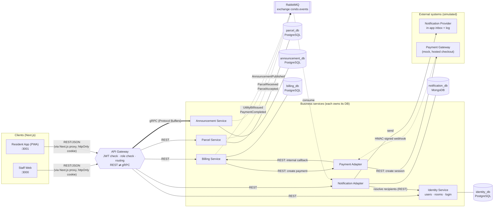
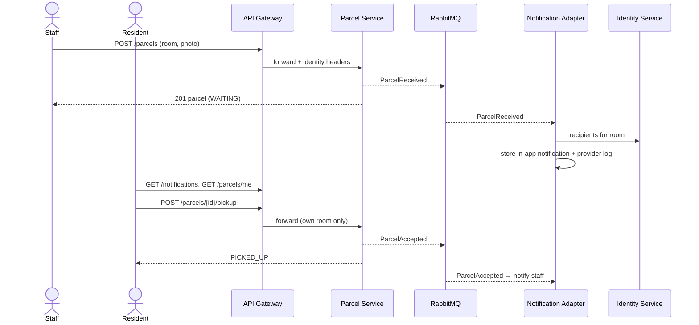
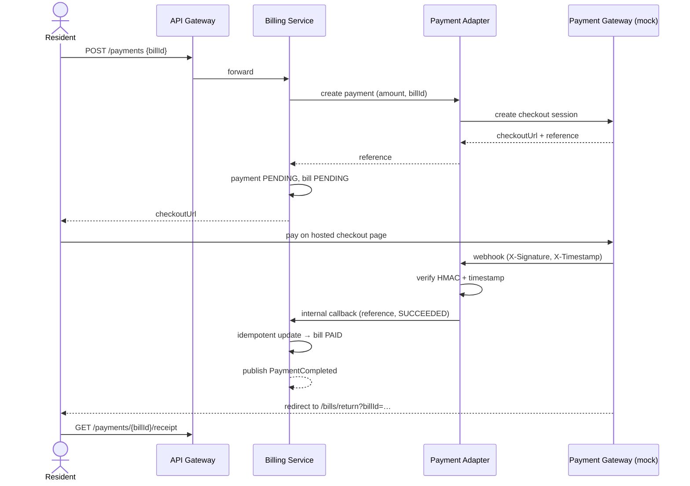
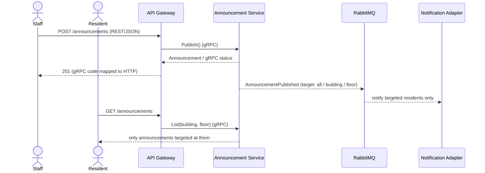

# Condominium Management System

Implementation of the SE 2110521 term-project spec (`spec/`): a platform where **residents** and **juristic staff**
manage parcels, utility bills/payments and announcements. Backend in **Go**, frontends in **Next.js**.

## Run it

Requirements: Docker (with Compose v2).

```bash
make up          # builds and starts everything (first build takes a few minutes)
make smoke       # end-to-end API check (needs curl + jq)
make down        # stop   (make clean also deletes the database volume)
```

| What | URL |
|---|---|
| Staff web app | http://localhost:3000 |
| Resident app (mobile-first) | http://localhost:3001 |
| API gateway | http://localhost:8080/api/v1 |
| Mock payment gateway (checkout page) | http://localhost:8090 |
| RabbitMQ UI (guest / guest) | http://localhost:15672 |
| MongoDB (Compass / mongosh) | mongodb://localhost:27018 |
| PostgreSQL | localhost:5433 (user/password `condo`) |

> Ports 3000/3001 busy? Set `STAFF_PORT` / `RESIDENT_PORT` in a `.env` file next to `docker-compose.yml`
> (e.g. `STAFF_PORT=3100`); the payment return URL and CORS origins follow automatically.

Demo accounts (password `password123`): `staff@condo.local`, and `resident1@condo.local` … `resident12@condo.local`
(residents 1–6 live in Building A, 7–12 in Building B; two floors × three rooms each).

### Try the three use cases
1. **Parcels** – sign in to the staff app, register a parcel for a room (optionally with a photo). Sign in to the
   resident app as that room's resident: a notification appears and the parcel shows under *Parcels*; tap **Confirm pickup**.
   Staff are notified and the parcel moves to *Picked up*.
2. **Utility bills** – staff issue a bill for one room or batch-enter a whole cycle. The resident sees it under *Bills*,
   taps **Pay**, is sent to the mock gateway checkout and chooses *Pay now* or *Fail payment*. The gateway sends a signed
   webhook; the bill becomes **Paid** and a receipt is available.
3. **Announcements** – staff publish to everyone, one building or one floor. Only targeted residents see it (and get notified).

## Architecture (maps to the ADRs)

### System overview



Solid arrows are synchronous calls, dotted arrows are asynchronous (events / webhooks), and the thick arrow is gRPC.

### Use case flows

**Parcel pickup (use case 1) — event-driven notification (ADR-03)**



**Paying a utility bill (use case 2) — third-party gateway (ADR-05)**



**Publishing an announcement (use case 3) — REST → gRPC (ADR-02)**



### Events (RabbitMQ topic exchange `condo.events`)

| Routing key | Published by | Consumed by → effect |
|---|---|---|
| `parcel.received` | Parcel | Notification → resident of that room |
| `parcel.accepted` | Parcel | Notification → all staff |
| `announcement.published` | Announcement | Notification → all / building / floor residents |
| `billing.bill_issued` | Billing | Notification → resident of that room |
| `billing.payment_completed` | Billing | Notification → resident of that room |

### Decisions

| ADR | Decision | Where |
|---|---|---|
| 01 Microservices | One service per business capability, each with its **own database** (PostgreSQL: `identity_db`, `parcel_db`, `announcement_db`, `billing_db`; MongoDB: `notification_db`) | `backend/cmd/*`, `backend/internal/*`, `deploy/postgres/init.sql` |
| 02 REST + gRPC | Clients use REST via the gateway; the gateway talks **gRPC** to the Announcement Service and maps gRPC↔HTTP status codes | `proto/`, `backend/internal/gateway/announcements.go` |
| 03 Event-driven notifications | Services publish `ParcelReceived`, `ParcelAccepted`, `AnnouncementPublished`, `UtilityBillIssued` (+ `PaymentCompleted`) to RabbitMQ; the Notification Adapter consumes them, deduplicating by event id | `backend/pkg/events`, `backend/internal/notification` |
| 04 Relational DB | PostgreSQL for users/rooms, parcels, announcements, bills and payments, with foreign keys inside a service (`payments.bill_id → utility_bills`, `rooms → buildings`) | `backend/internal/*/schema.sql` |
| 06 NoSQL for notifications *(added)* | The Notification Adapter stores notifications as documents in **MongoDB**: write-heavy, event-shaped, only read per user. A unique `(event_id, user_id)` index makes event handling idempotent | `backend/internal/notification`, [`docs/adr-06-nosql-notifications.md`](docs/adr-06-nosql-notifications.md) |
| 05 Third-party payment gateway | Billing only stores `paymentReference, billId, amount, paymentStatus, paidAt`. Gateway webhooks are HMAC-signed, timestamp-checked and applied idempotently | `backend/internal/paymentadapter`, `backend/pkg/webhook`, `backend/internal/mockgateway` |

Notes and deliberate choices:
- **Identity Service** is not drawn in the spec's diagram; it exists because `/users` and `/rooms` need an owner and the gateway needs JWTs.
- The gateway only routes a whitelist of public paths, so `/internal/*` endpoints (payment callback, recipient lookup) are unreachable from outside.
  Identity travels downstream as `X-User-*` headers set by the gateway after verifying the JWT (client-supplied copies are stripped).
- The Notification **Provider** and **Payment Gateway** are simulated: notifications are stored for the in-app inbox and a "send" line is logged;
  the mock gateway hosts a checkout page and calls the webhook like a real PSP would.
- The Next.js apps keep the JWT in an `httpOnly` cookie and proxy API calls through `/api/gw/*`, so the token never reaches browser JS.
- Overdue is derived at read time (`UNPAID` and past due date).
- Water/electricity rates are config (`WATER_RATE`, `ELECTRIC_RATE`, default 18 and 7 THB per unit).

## Demo

A timed (< 5 min) video script covering all use cases, both database types and RabbitMQ is in [`docs/DEMO.md`](docs/DEMO.md).

## Layout

```
backend/    Go module: cmd/<service>/main.go, internal/<service>/, pkg/ (shared), gen/ (protobuf code)
proto/      announcement.proto (+ buf config; `make proto` regenerates backend/gen)
web/        npm workspaces: staff-web, resident-app, packages/shared (types, API proxy, UI kit)
deploy/     postgres init script          scripts/smoke.sh   end-to-end check
```

## Development without Docker for the apps

```bash
docker compose up -d postgres rabbitmq gateway identity parcel announcement billing notification-adapter payment-adapter mock-gateway
cd web && npm install && npm run dev:staff     # :3000   (GATEWAY_URL defaults to http://localhost:8080)
cd web && npm run dev:resident                 # :3001
cd backend && go vet ./... && go test ./...
```
